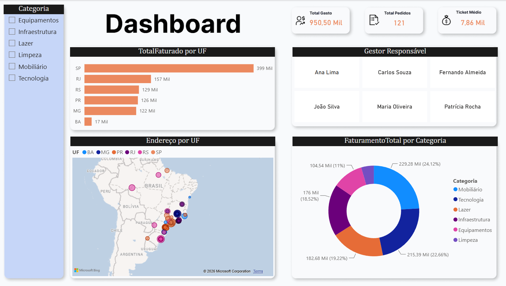
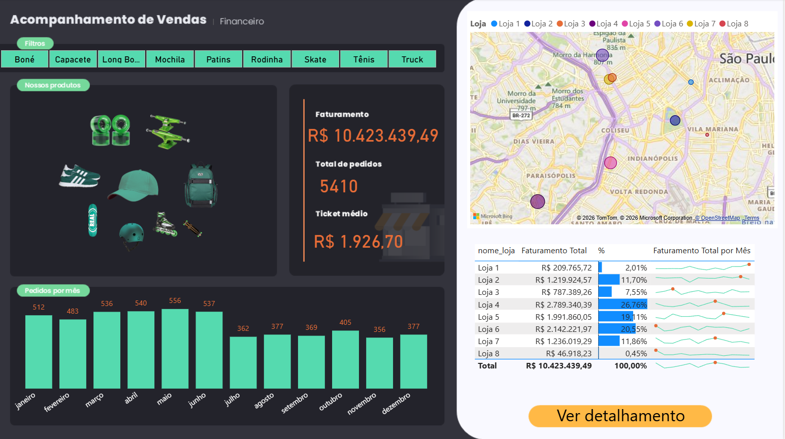
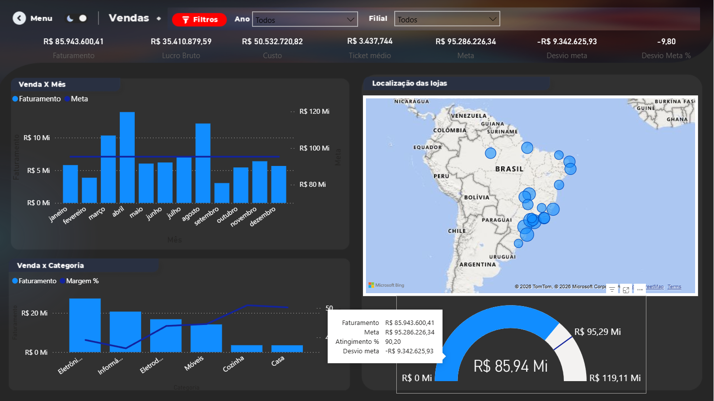

# Fundamentos Power BI

Este repositório reúne uma série de projetos de dashboard desenvolvidos com Microsoft Power BI, focados em análise de dados, visualização de indicadores e criação de relatórios executivos.

O objetivo principal foi praticar e consolidar conhecimentos em:

- modelagem de dados;
- criação de KPIs e métricas;
- uso de slicers e filtros;
- visualizações de desempenho e tendências;
- mapas geográficos e análise por região;
- storytelling de dados com dashboards profissionais.

## Visão geral dos projetos

### 1) Análise de Gastos Empresariais

Dashboard voltado para acompanhamento de despesas e indicadores financeiros de uma organização, com foco em categorias e comportamento de gasto.



- Arquivo: `PrimeiroProjeto-AnaliseGastos/ProjetoGastosEmpresariais.pbix`
- Destaques: somatório de gastos, comparação por categoria, mapa de desempenho e visão por unidade funcional.

### 2) Projeto Sport Store

Dashboard de e-commerce / varejo esportivo com visão geral de vendas, ticket médio, categoria e desempenho por loja.



- Arquivo: `SegundoProjeto-SportStore/ProjetoSportStore.pbix`
- Destaques: análise de faturamento, distribuição por categoria, desempenho por loja, mapas e KPIs comerciais.

### 3) Acompanhamento de Vendas

Dashboard de acompanhamento comercial com foco em faturamento, metas, variação, produtos e indicadores de performance por mês e localização.



- Arquivo: `TerceiroProjeto-AcompanhamentoVendas/AcompanhamentoVendas.pbix`
- Destaques: comparação entre faturamento e meta, vendas por mês, categoria, distribuições geográficas e análise por loja.

## Estrutura do repositório

```text
Fundamentos-Power-BI/
├── LICENSE
├── README.md
├── PrimeiroProjeto-AnaliseGastos/
│   ├── dashboard1.png
│   └── ProjetoGastosEmpresariais.pbix
├── SegundoProjeto-SportStore/
│   ├── dashboard2.png
│   └── ProjetoSportStore.pbix
├── TerceiroProjeto-AcompanhamentoVendas/
│   ├── dashboard3.png
│   └── AcompanhamentoVendas.pbix
└──
```

## Como abrir os projetos

1. Instale o Microsoft Power BI Desktop.
2. Abra o arquivo `.pbix` correspondente ao projeto desejado.
3. Explore os relatórios, filtros e visuais interativos.

## Tecnologias e recursos utilizados

- Microsoft Power BI
- Power Query
- Modelagem de dados
- Medidas DAX
- Visualizações customizadas
- Mapa e geolocalização
- KPIs e cards de indicadores

## Observações

Este repositório foi criado como material de prática e estudo em Power BI, com foco no desenvolvimento de dashboards analíticos e na apresentação visual de dados de negócio.

## Licença

Este projeto está licenciado sob a licença MIT. Consulte o arquivo [LICENSE](./LICENSE) para mais detalhes.
